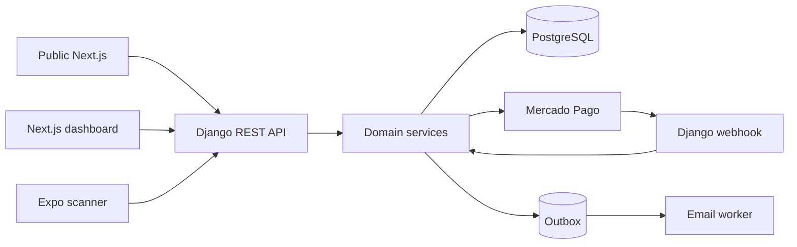
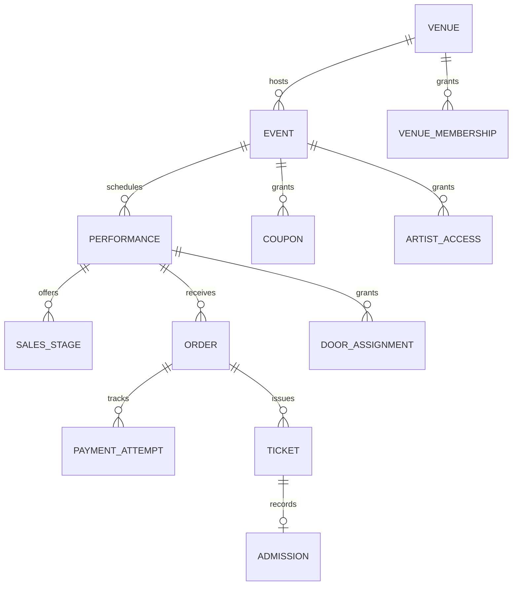

# Architecture Spine — Ticketera Popular

## Design Paradigm

A modular Django monolith owns business state. Each domain app exposes read and write **services**; DRF ViewSets in `rest.py` or `rest/` adapt HTTP to those services. There is no selectors layer. Next.js serves the public site and the venue, artist, and door dashboard; Expo serves QR admission. Both clients use the Django API. Django Admin is for internal platform operations.



## Invariants & Rules

### AD-1 — Shared state and dependency direction [ADOPTED]

- **Binds:** all capabilities.
- **Prevents:** web, mobile, and admin implementing incompatible business rules.
- **Rule:** Django services own all mutations and authoritative reads of shared state. Next.js, Expo, ViewSets, and Django Admin may not write business tables or integrate directly with Mercado Pago for business operations. Domain services may depend on provider adapters; providers and presentation layers may not be depended on by domain rules.

### AD-2 — Venue and role boundary [ADOPTED]

- **Binds:** FR-1, FR-3, FR-11–FR-12, FR-15–FR-19.
- **Prevents:** cross-venue access and inconsistent permissions across clients or exports.
- **Rule:** Django owns identity and every protected service query and command is scoped server-side to venue, event, or performance membership. Platform admins grant venue admin access; venue admins grant artist and door access; artists read only associated events; door staff act only on assigned performances. UI hiding is never authorization.

### AD-3 — Offer, capacity, and coupon serialization

- **Binds:** FR-2, FR-4–FR-5, FR-7–FR-8, FR-10.
- **Prevents:** concurrent oversell, premature stage opening, and coupon overuse.
- **Rule:** One checkout service owns a PostgreSQL transaction that locks performance capacity, current stage allocation, and coupon uses together. Server time selects a stage; unsold allocation rolls only at the next scheduled opening. A sold-out stage pauses sales. An unpaid hold expires after **15 minutes**, releasing capacity and reserved coupon uses. No online issuance can exceed capacity or coupon limits.

### AD-4 — Payment reconciliation and fulfillment [ADOPTED]

- **Binds:** FR-8–FR-10, FR-13, FR-17.
- **Prevents:** browser-return fulfillment, duplicate tickets or emails, and stale payment status at the door.
- **Rule:** Checkout Pro redirects the buyer to Mercado Pago using the venue's account. Django validates webhook authenticity, fetches provider state, and runs one idempotent reconciliation service for webhook and staff refresh. Paid orders issue tickets only after confirmed approval; a 100% invitation uses the same idempotent issuance path without a payment attempt. Ticket issuance and buyer-confirmation and authorized sale-notification outbox entries commit atomically; the worker retries delivery without creating another order or ticket. Pending, failed, and late outcomes remain in history and are visible to authorized staff.

### AD-5 — Late approval cannot oversell

- **Binds:** FR-8, FR-17, capacity accuracy.
- **Prevents:** a payment approved after its 15-minute hold expires from creating an invalid admission or exceeding capacity.
- **Rule:** Reacquire capacity, applicable stage allocation, and coupon uses atomically on late approval. Fulfill at locked sale-time terms only if all remain available; otherwise record a paid-unfulfilled exception, issue no valid ticket, and surface it for operator resolution. The buyer-facing and refund handling of this exception must be settled before live payments.

### AD-6 — Historical sales ledger

- **Binds:** FR-7–FR-14, FR-18.
- **Prevents:** reports changing with later price edits or web and mobile totals disagreeing.
- **Rule:** One pricing service calculates the event's fixed fee or percentage of the undiscounted ticket price; a partial coupon never lowers the fee, and a 100% invitation waives both price and fee. Persist sale-time price, discount, fee, total, stage, coupon, payment outcome, source channel, and later adjustments separately. Venue and artist views and exports read the same backend sales facts. Cash sales, invitations, and online payments retain distinct provenance. A performance has one manual `rendered` state; no money distribution occurs in the product.

### AD-7 — Admission authority [ADOPTED]

- **Binds:** FR-15–FR-18.
- **Prevents:** duplicate digital admissions and mixing paper and digital marks.
- **Rule:** Web lookup and Expo scan call the same atomic admission service. Each ticket can be digitally admitted once; duplicate response includes authorized evidence. Admission mode is per performance: paper locks at list generation, digital locks at first mark. The paper list is a snapshot with pending attempts marked separately; later approvals require a documented door exception and current-status check, never a silent list rewrite. Manual admission of a pending buyer remains historical even if payment later fails. Paper attendance and offline cash sales are entered later as separate audited actions; a same-day cash sale atomically counts as one admission, and offline over-capacity entry warns but preserves the fact of the sale.

### AD-8 — Ticket identifiers [ADOPTED]

- **Binds:** FR-8, FR-15–FR-16.
- **Prevents:** colliding codes, dictation errors, and buyer data leakage through QR.
- **Rule:** Generate a globally unique, random, eight-character human code from an uppercase alphabet excluding ambiguous characters; enforce a database uniqueness constraint and retry collisions. QR uses a separate opaque random token with its own uniqueness constraint. Neither identifier embeds buyer data. Only assigned staff can resolve ticket details.

### AD-9 — Operational envelope

- **Binds:** all paid, admission, and reporting flows.
- **Prevents:** deployment drift and untraceable payment or door failures.
- **Rule:** Keep separate staging and production credentials and data. Deploy API, web, and durable worker against managed PostgreSQL; store media durably, back up the database, keep secrets outside source, and record payment, fulfillment, admission, and worker failures with correlation IDs. Rehearse webhook redelivery, backup restore, and door workflows before the first paid event. Provider and recovery targets remain launch decisions.

### AD-10 — Door response target [ADOPTED]

- **Binds:** FR-15–FR-16.
- **Prevents:** slow scans causing a queue or ambiguous retries causing duplicate scans.
- **Rule:** In the connected pilot door setup, show a definitive scan result within two seconds at the measured target load. A timeout shows an explicit retry state; the client does not infer admission success. Verify the target in the door rehearsal.

### AD-11 — Publication authority

- **Binds:** FR-3, FR-6–FR-7.
- **Prevents:** public clients or caches exposing drafts and performances at different times.
- **Rule:** Django catalog services decide public visibility from the event and each performance's independent publication state and server time. Venue-admin preview is a separately authorized read. Public API responses never include unpublished records; web caches may not override that boundary.

## Consistency Conventions

| Concern | Convention |
| --- | --- |
| Backend structure | Services handle reads and writes; thin DRF ViewSets in each app's `rest.py` or `rest/`; no selectors. |
| Web UI | Next.js dashboard and public site use Tailwind and shadcn/ui components; Django Admin serves internal platform staff. |
| API | Versioned REST boundary; stable opaque IDs; explicit venue/event/performance scope; errors use one machine-readable code and human message. |
| Time and money | Store UTC instants and ARS amounts in integer minor units; present times in the venue's timezone. Snapshot financial values at sale time. |
| State transitions | Named service operations with database transactions and idempotency keys; callbacks are signals to fetch authoritative provider state. |

## Stack

| Name | Version |
| --- | --- |
| Django | 6.1.3 |
| Django REST Framework | 3.17.2 |
| Next.js | 16.4 series |
| Expo SDK | 58 |
| Tailwind CSS | 4.3 |
| PostgreSQL | 18 |

Versions were checked on 2026-11-10 against the official release and support pages; implementation pins the exact compatible patch set when applications are scaffolded.

## Structural Seed

```text
backend/      Django apps, services, REST adapters, provider adapters, worker
web/          Next.js public pages and role-scoped dashboard
mobile/       Expo admission client
```



## Capability → Architecture Map

| Capability | Lives in | Governed by |
| --- | --- | --- |
| FR-1–FR-6 publication, offers, discovery | Catalog services; public web | AD-1–AD-3, AD-11 |
| FR-7–FR-10 pricing, checkout, coupons, email | Checkout/payment services; public web; worker | AD-3–AD-5, AD-8 |
| FR-11–FR-14 artist reporting, venue payment, rendition | Access/reporting services; dashboard | AD-2, AD-4, AD-6 |
| FR-15–FR-18 digital/paper admission, cash | Admission services; Expo; dashboard | AD-2, AD-5–AD-8, AD-10 |
| FR-19 role boundaries | Identity/access services; all clients | AD-2 |

## Deferred

- **Before live payments:** Verify Checkout Pro Orders API with El Taller's venue account and choose the provider API path; provision credentials per venue; settle late paid-unfulfilled buyer communication and refund procedure, refund/chargeback and processor-fee accounting, sale-notification recipients, and buyer-data retention (PRD OQ-5, OQ-7).
- **Before door rehearsal:** mistaken admission correction authority, paper-list buyer fields and pending-payment layout, offline over-capacity operating procedure (PRD OQ-1, OQ-6).
- **Before launch commitment:** hosting provider, recovery objectives, exact event dates and delivery feasibility (PRD OQ-8).
- **At UX design:** publication confirmation and event-grid order (PRD OQ-2).
- **At coupon acceptance tests:** multi-ticket coupon case and any performance restriction (PRD OQ-4).
- **At multi-venue or multi-type rollout:** self-service Mercado Pago OAuth onboarding; additional ticket types, zones, and seating (PRD OQ-3).
